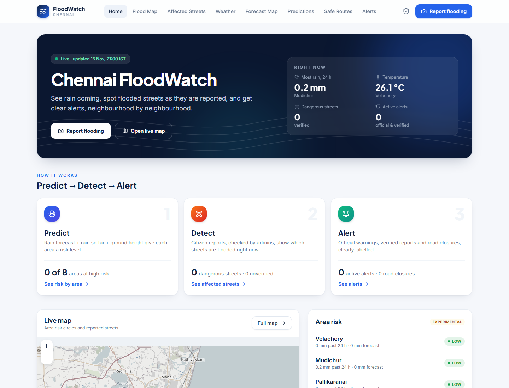
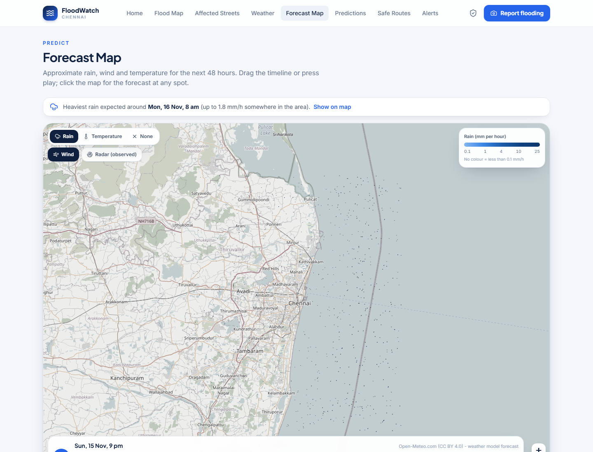
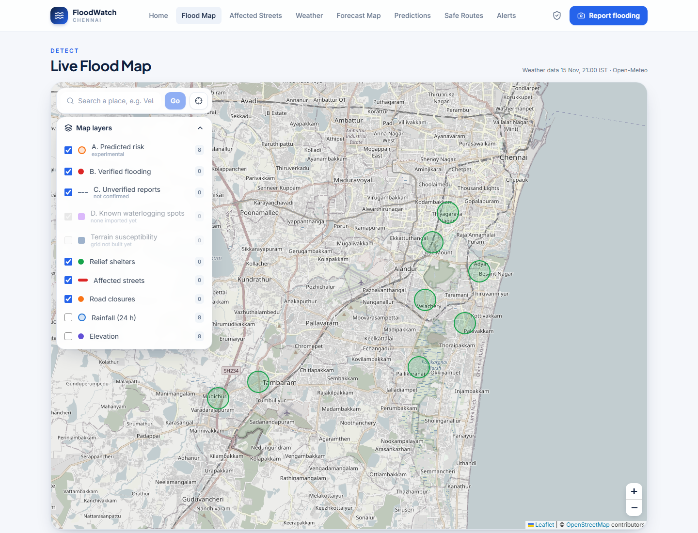
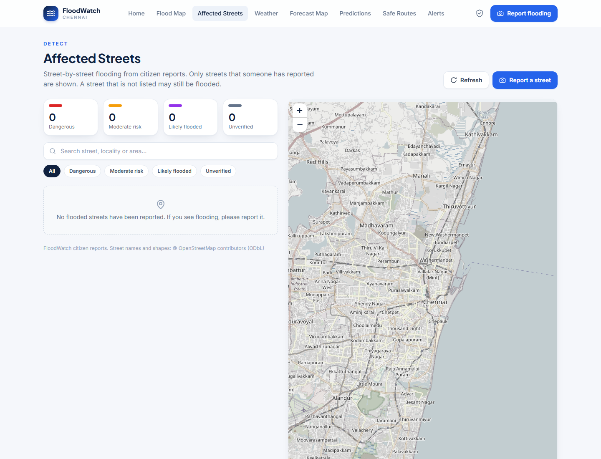

# 🌊 Chennai FloodWatch

A website that shows rainfall, flood reports, flood risk and road closures for Chennai.

- **Frontend:** React + Vite + Tailwind CSS + Leaflet maps (`frontend/`)
- **Backend:** Python + FastAPI (`backend/`)
- **Database:** SQLite (a single file, `backend/floodwatch.db`, created automatically)

## Screenshots

| Home (Predict → Detect → Alert) | Forecast map (48 h rain / wind / temperature) |
|---|---|
|  |  |
| **Live flood map** | **Affected streets** |
|  |  |

More in the [screenshots](screenshots/) folder.

## Folder structure

```
floodwatch/
├── backend/
│   ├── main.py           ← all API routes
│   ├── database.py       ← tables + the 8 Chennai areas
│   ├── weather.py        ← real weather from Open-Meteo
│   ├── risk.py           ← simple EXPERIMENTAL risk score
│   ├── auth.py           ← admin login (bcrypt + JWT)
│   ├── create_admin.py   ← makes an admin account
│   └── test_main.py      ← backend tests
├── frontend/src/
│   ├── pages/            ← one file per page (Home, FloodMap, Weather, ...)
│   ├── components/       ← Navbar + small shared pieces
│   ├── api.js            ← talks to the backend
│   └── App.test.jsx      ← frontend tests
└── ml/train.py           ← optional, only for REAL flood data
```

## How to run it (Windows)

You need **Python 3.11+** and **Node.js 18+**.

**1. Backend** (first terminal):

```bash
cd backend
python -m venv .venv
.venv\Scripts\activate
pip install -r requirements.txt
copy .env.example .env               # then open .env and change JWT_SECRET
python create_admin.py you@example.com YourPassword123
uvicorn main:app --reload
```

The API runs at http://localhost:8000, and the docs are at http://localhost:8000/docs.

**2. Frontend** (second terminal):

```bash
cd frontend
npm install
npm run dev
```

Open **http://localhost:5173**. Admin login is at http://localhost:5173/admin.

## Running the tests

```bash
cd backend  &&  .venv\Scripts\activate  &&  pytest -v     # 60 tests
cd frontend &&  npm test                                  # 37 tests
```

The tests use a fake weather API and a fake backend, so they work offline.

## Pages

| Page | What it does |
|---|---|
| Home | Rainfall, verified reports, risk areas, announcements, emergency numbers, map preview |
| Flood Map | Map with layers you can turn on/off: predicted risk, verified flooding, unverified reports, road closures, rainfall, elevation. Has search and "my location". |
| Affected Streets | Street-by-street flooding from citizen reports, grouped by area. Street names and shapes come from OpenStreetMap; only ~150 m around each report is highlighted. Search + "verified only" filter. |
| Weather | Live rainfall table for 8 areas + hourly rain chart |
| Report Flooding | Form with GPS or map click, water depth, severity, photo |
| Predictions | Risk level per area, with an explanation of the rule |
| Safe Routes | Driving routes with known closures/verified flooding marked |
| Alerts | Alerts labelled OFFICIAL / VERIFIED REPORT / PREDICTION, road closures, browser notifications |
| Admin | Verify/reject/resolve reports, publish alerts, add/remove road closures |

## Predict → Detect → Alert (all software, no hardware)

| Step | What the system does | Where |
|---|---|---|
| **Predict** | Area risk from rainfall (IMD categories) + ground height | `risk.py`, Predictions page |
| **Predict** | **Street-level** forecast: area rainfall × flood history (verified reports + imported waterlogging spots within 300 m) × terrain (height above the local river/lake level and distance to water) | `terrain.py`, "Check your street" |
| **Predict** | Sea level / tides near the Adyar mouth (high sea slows drainage) | `/api/tide`, Weather page |
| **Predict** | **Forecast Map**: next 48 h of rain / temperature as smooth colour fields, animated wind, timeline with play button, click any spot for its forecast, optional observed radar (RainViewer). Approximate: models are ~10–25 km | `forecast.py`, `frontend/src/forecast/`, Forecast Map page |
| **Predict** | Track record: every prediction is saved and checked 24 h later against verified reports | `/api/risk/track-record` |
| **Detect** | Streets classed **Dangerous / Moderate risk / Likely flooded / Unverified** (never "safe") | Affected Streets page |
| **Detect** | **Likely flooded** = 3+ different people reported the street in the last hour; shown first to admins | `/api/streets`, admin queue |
| **Detect** | Verified reports **expire after 6 h** unless an admin re-confirms them | `ACTIVE_HOURS` in `main.py` |
| **Alert** | **Automatic area alerts** when dangerous flooding (≥ 30 cm or HIGH/SEVERE) is verified, or an area reaches HIGH risk; deduplicated, expiring | `create_auto_alert` |
| **Alert** | "My areas" + browser notifications (checked every minute while the site is open) | Alerts page |
| **Alert** | Routes that **try detours** around closures/verified flooding, and **evacuation** to the nearest relief shelter | `routing.py`, Safe Routes page |
| **Alert** | **Briefing for emergency authorities** (print / CSV) | Admin → Briefing |

### Street-level terrain grid
On first start the backend builds a ~650 m grid over south & central Chennai (`backend/data/` keeps the
downloaded heights and river/lake shapes, so rebuilding is quick). You can also run `python terrain.py`
or use Admin → Data → Rebuild.

**Honest check of the terrain score** against places known to flood: Mudichur came out HIGH;
Pallikaranai, Perungudi and Madipakkam MEDIUM; but Velachery, Kotturpuram and Saidapet LOW, because the
90 m height model includes buildings. Known dry places (Tambaram hills, Guindy, Chromepet) were LOW/MEDIUM.
That is why terrain is labelled *low confidence* and **flood history** carries more weight. Import an
official waterlogging list (Admin → Data, CSV `name,latitude,longitude`) to improve it.

## Important rules this project follows

- **No fake data.** If Open-Meteo is down, the site says "service unavailable" instead of showing invented numbers.
- **Unverified ≠ verified.** Citizen reports stay "UNVERIFIED" (grey) until an admin verifies them. Photos only become public after verification.
- **Risk is EXPERIMENTAL.** `risk.py` is a simple rule (IMD rainfall categories + elevation). It is **not** a trained model and has **not** been tested against real floods.
- **No route is called "safe".** Only admin-entered closures and verified reports are used to warn about routes.

## Data sources

| Data | Source | Licence |
|---|---|---|
| Weather (model data, not rain gauges) | [Open-Meteo](https://open-meteo.com) | CC BY 4.0 |
| Elevation | Copernicus DEM 90 m via Open-Meteo | free with attribution |
| Map tiles, roads | OpenStreetMap | ODbL |
| Routing | [OSRM](https://project-osrm.org) public demo server | light use only |
| Place search | Nominatim | max 1 request/second |

## Limitations / what could be added next

1. **Historical data must be imported.** Map layer "D" shows known waterlogging spots only after an admin imports an official list.
2. **No real ML model.** `ml/train.py` shows how to train one *once you have real, dated flood records*; the track record collects them over time.
3. **Browser notifications** only work while the site is open. Real push notifications (when the site is closed) would need Firebase Cloud Messaging.
4. **Relief shelters** must be entered by admins from official lists; evacuation routing needs at least one.
5. The OSRM and Nominatim servers are free demo services. For a real public launch, run your own.

## Putting it online with Vercel

The whole app (website + backend) runs on Vercel. Data is kept in a free **Neon PostgreSQL**
database; on your computer the app keeps using SQLite. Report photos are stored in the database.

1. **Import the project:** on [vercel.com](https://vercel.com) → **Add New… → Project** → import the
   `chennai-floodwatch` GitHub repository. Keep the settings Vercel shows (they come from `vercel.json`).
2. **Add settings** (Environment Variables) before clicking Deploy:

   | Name | Value |
   |---|---|
   | `JWT_SECRET` | a long random text, e.g. from `python -c "import secrets; print(secrets.token_hex(32))"` |
   | `ADMIN_EMAIL` | the email you will log in with |
   | `ADMIN_PASSWORD` | at least 10 characters |

3. **Deploy.** The website appears; the API answers "Database not connected" until step 4.
4. **Connect the database:** project → **Storage → Create Database → Neon** (free) → connect it to the
   project. This adds `DATABASE_URL` automatically.
5. **Redeploy:** project → **Deployments → ⋯ → Redeploy**. Tables, the 8 areas, the terrain grid and
   your admin account are created on the first request.

After that, every `git push` to `main` deploys automatically.

How it fits together: `vercel.json` builds `frontend/` and sends `/api/...` to `api/index.py`, which runs
the FastAPI app from `backend/`. The root `requirements.txt` lists the backend packages for Vercel.

Limits on Vercel: photos up to 4 MB; the terrain grid is loaded from `backend/data/grid_cells.json`
(rebuild it on your computer with `python terrain.py`, then commit and push); browser notifications and
caches work per visit; Open-Meteo, OSRM and Nominatim are free shared services and may occasionally
refuse requests from busy cloud servers - the site then shows "service unavailable" instead of guessing.

To test the backend against PostgreSQL locally: `set TEST_DATABASE_URL=postgresql://...` then `pytest`.

⚠️ This is a student project, **not** an official warning system. In an emergency, call **112**.
